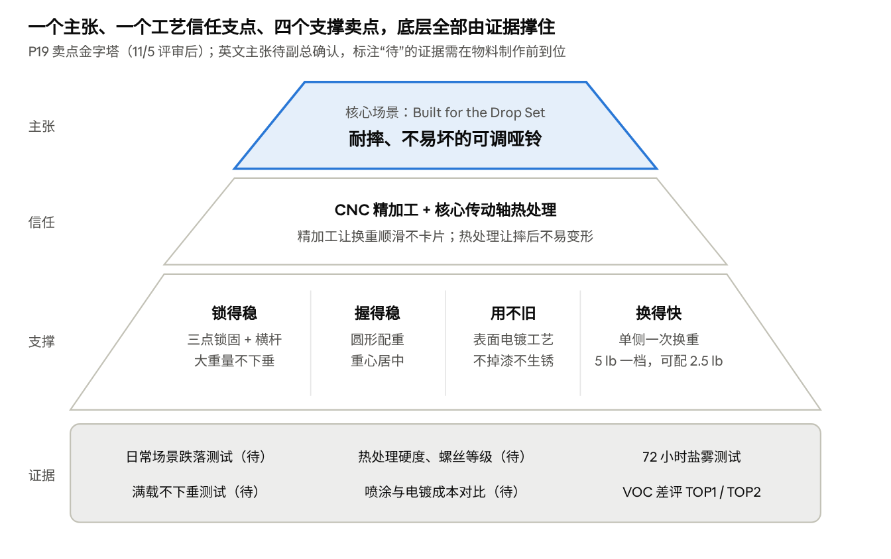

# MERACH P19 产品营销方案

Nov 4, 2026 · @Cristobal

P19（MRK-65LB，65 lb 可调节哑铃）计划于 2027 年 2 月在美国、德国上市，渠道为品牌独立站与 Amazon。根据 11 月 5 日评审，产品主张调整为“耐摔、不易坏的可调哑铃”，不再使用“摔不坏”；信任支点由“全金属”调整为“CNC 精加工 + 核心传动轴热处理”；Built for the Drop Set 仍为核心使用场景。本文档为产品营销交付物，整合营销打法见《MERACH P19 整合营销方案》。

**本版调整（依据 11 月 5 日评审）**

- 主张：“摔不坏”改为“耐摔、不易坏”。内容可以大量展示耐摔，但不引导用户故意摔打。
- 信任支点：多数耐摔竞品同样是全金属，“全金属”不构成差异，改为 CNC 精加工与热处理。
- 新增卖点：大重量两头不下垂（三点锁固 + 中间横杆 + 两根支撑杆）、表面电镀工艺、单侧一次换重、圆形配重带来的平衡与握持。
- 删除卖点：“400 mm 紧凑”不再作为卖点；按重量归一化后，P19 的长度不占优。
- 档位表述：5 lb 一档；2.5 lb 需加配定制微调片。
- 表达方式：卖点一律先用用户语言讲“得到什么”，技术参数作为证据放在后面。

## 一、产品营销方案 V2

### 1. 目标人群

核心人群为美国 Garage Gym 增肌用户与德国 Homegym 力量训练者；城市小户型与女性入门用户为第二梯队；Bowflex 替换用户为机会型人群。

| 人群 | 市场 | 优先级 | 核心痛点 | 对应卖点 | 证据强度 |
| --- | --- | --- | --- | --- | --- |
| P1 Garage Gym 增肌玩家 | 美国 | 核心 | 旋转式必须放回底座换重、尼龙件易坏；大重量时担心两头下垂、掉片 | 离座单侧快调、耐摔不变形、大重量不下垂 | 中 |
| P2 Homegym 力量训练者 | 德国 | 核心 | 低价品牌塑料件易坏、掉漆生锈；高端选择少 | CNC 精加工、表面电镀、测试报告与认证 | 中 |
| P3 城市小户型训练者 | 美国 / 德国 | 次要 | 空间小、担心噪音 | 一副替代整排哑铃；换重安静 | 中 |
| P4 女性与入门力量训练者 | 美国为主 | 次要（增长型） | 起步重量偏高、档位跨度大 | 5 lb 一档，可配 2.5 lb 微调片 | 强 |
| P5 Bowflex 替换用户 | 美国 | 机会型 | 担心配重片脱落 | 三点锁固 + 中间横杆，两头不下垂 | 中 |

**画像依据与验证**

画像按三步得出：用产品卖点反推“谁最需要”，用内部 VOC 与销售数据确定人群和占比，用公开调研与竞品测评补充画像细节。人群划分有数据支撑；年龄、性别等细节属于推断，需在上市前验证。

| 人群 | 已有依据 | 证据强度 | 尚属推断的部分 |
| --- | --- | --- | --- |
| P1 Garage Gym 增肌玩家 | 内部 VOC：差评 TOP1“调节困难 / 卡顿”92 次、好评 TOP2“调节速度快”78 次；YouTube 测评指出长度是核心关注点；CivicScience：自有住房者 43% 拥有家用器材 | 中 | 年龄、性别、递减组使用比例 |
| P2 德国 Homegym 力量训练者 | YouGov：19% 德国人自行训练，其中 15% 做哑铃或举重训练；Amazon.de 品类以低价品牌为主 | 中 | 年龄、对认证与测评的依赖程度 |
| P3 城市小户型训练者 | 内部 VOC：80% 用户因空间有限选择速调哑铃；CivicScience：租房者器材渗透率 31% | 中 | 年龄、对噪音的关注度 |
| P4 女性与入门力量训练者 | 内部数据：女性用户 35% 且快速增长，小重量款月均 668 件；差评 TOP10“重量档位跨度太大” | 强 | 年龄、触点偏好 |
| P5 Bowflex 替换用户 | CPSC 召回：约 380 万副；内部 VOC：差评 TOP2“调节机构不可靠 / 锁不住”75 次 | 中 | 实际搜索替代品的规模 |

内部 VOC 的数据来源（平台、竞品范围、时间段、样本量）需在汇报时一并注明。上市前验证方式：

1. **Amazon Brand Analytics：** 查看竞品 ASIN 购买人群的年龄、性别、收入分布，校验 P1、P3、P4。
2. **竞品评论挖掘：** 统计 REP、NÜO、Snode 评论中提及 drop set、apartment、wife / she 等场景词的占比，校验场景判断。
3. **Meta 受众洞察：** 按兴趣（home gym、bodybuilding、strength training）查看美德两地受众规模与年龄结构。
4. **搜索数据：** 用 Google Trends 与 Amazon 搜索词报告验证 drop set、bowflex alternative 等词的搜索量。
5. **老用户问卷：** 通过 Klaviyo 向 MERACH 现有力量类用户发放简短问卷，确认训练习惯与购买决策因素。

**P1 美国 Garage Gym 增肌玩家（核心）**

- **基本特征：** 男性为主，约 28–45 岁，自有住房，车库或地下室已配深蹲架与卧推凳。美国自有住房者中 43% 拥有家用健身器材，高于租房者的 31%。
- **训练场景：** 训练 3 年以上，以增肌为目标，常用递减组、超级组，哑铃用于推胸、推肩、飞鸟等动作。
- **痛点：** 固定哑铃一整排占地且投入高；旋转式可调哑铃必须放回底座才能换重、尼龙齿轮易坏；哑铃过长导致推胸撞膝、推肩撞肩。
- **购买决策：** 先看测评再下单，关注耐用性、换重速度、整机长度与质保；竞品集中在 $700–900，会与 REP 直接比较。
- **信息触点：** GGR、BarBend、Garage Gym Lab、YouTube 测评与跌落测试视频、Reddit r/homegym、HomeGymCon。
- **沟通话术：** “Drop the weight, not the set.”

**P2 德国 Homegym 力量训练者（核心）**

- **基本特征：** 男性为主，约 30–50 岁，在公寓或地下室（Keller）训练。德国 19% 的人自行训练，其中 15% 进行哑铃或举重训练；高收入人群自练比例更高（23% vs 18%）。
- **训练场景：** 以力量训练（Krafttraining）为主，常结合健身 App 安排计划。
- **痛点：** Amazon.de 主流为低价品牌，塑料件易坏、掉漆生锈；高端选择少，主要只有 NÜO。
- **购买决策：** 理性、重证据，查阅测试报告（Testbericht）、GS / TÜV 认证与质保（Garantie）；要求 kg 标注、德语说明与本地售后。
- **信息触点：** Amazon.de、测评比价站、德语 YouTube 健身博主、FIBO；线下会参考 Decathlon 等运动零售。
- **沟通话术：** “Massiver Stahl. Gebaut für Drop Sets.”

**P3 城市小户型训练者（次要）**

- **基本特征：** 约 25–40 岁，租房或小户型公寓，用家用器材替代或补充健身房会员。内部 VOC 显示 80% 的用户因空间有限选择速调哑铃。
- **痛点：** 空间小、担心噪音影响邻居、哑铃太长不好收纳。
- **购买决策：** 看尺寸、收纳方式与外观是否适合放在客厅。
- **信息触点：** Amazon 搜索、Instagram / TikTok 家居健身内容。
- **沟通话术：** “One pair. Every weight.”

**P4 女性与入门力量训练者（次要，增长型）**

- **基本特征：** 约 25–45 岁，力量训练入门或以塑形为目标。内部数据显示女性用户占 35% 且快速增长，小重量款月均 668 件。
- **痛点：** 多数可调哑铃起步重量偏高、档位跨度 5–10lbs 太大，操作复杂。
- **购买决策：** 上手难度、小重量档位、外观与安全性。
- **信息触点：** Instagram、TikTok、女性健身博主、独立站内容。
- **沟通话术：** “Start light. Go further.”
- 银发（6%）与康复用户（12%）不单独投放，由本人群的小重量内容覆盖。

**P5 Bowflex 替换用户（机会型）**

- **基本特征：** 已持有旋转式可调哑铃，包括 2025 年召回的 SelectTech 552 / 1090 用户（约 380 万副）。
- **痛点：** 担心配重片脱落，对安全敏感。
- **购买决策：** 主动搜索 bowflex alternative、safe adjustable dumbbells 等关键词，关注锁固结构。
- **沟通话术：** “Locks tight. No sag.”（不点名竞品）

### 2. Slogan

| 层级 | 英文 | 德文 | 中文释义 | 使用场景 |
| --- | --- | --- | --- | --- |
| 产品主张（英文待副总确认） | 建议：Built to Take the Drop；原 V2：The Last Dumbbell You'll Ever Drop | 待本地化 | 耐摔、不易坏的可调哑铃 | KV、主图、产品页与 Explore 页首屏、上市 Campaign |
| 信任支点 | Precision-Machined. Heat-Treated. | Präzisionsgefertigt. Wärmebehandelt. | CNC 精加工、核心传动轴热处理 | KV 副标题、卖点信息图、工艺讲解视频 |
| 核心场景 | Built for the Drop Set | Gebaut für Drop Sets | 为递减组而生 | 场景内容、创作者内容、P1 人群素材 |

措辞原则：讲“耐摔”，不讲“摔不坏”。原 V2 英文主张容易被理解为“怎么摔都不会坏”，是否保留需与副总确认。对外表述须注明测试条件，并说明正常使用场景（如铺设减震地胶）；人为测试性摔打不在保修范围内。

人群沟通语：

- Drop the weight, not the set.
- Massiver Stahl. Gebaut für Drop Sets.
- One pair. Every weight.
- Start light. Go further.（需加配微调片）
- Locks tight. No sag.（不点名竞品）

德文表述需由德语母语者校对。所有 Slogan 需先完成商标检索；“Built for the Drop Set”可能因描述性较强难以注册。

### 3. KV 视觉

视觉方向：深色硬核训练场景，哑铃落地瞬间为画面焦点，突出电镀金属质感；人物为递减组力竭状态，传达“练到力竭、放心放下”。

（KV V1 品牌化版本：图片见 Claude Docs 原文）

（KV 草稿 AI 生成版本：图片见 Claude Docs 原文）

KV 上线前需处理：

- **草稿版本不可对外使用。** 卧推凳上可见 REP 字样，右下角有“AI生成”水印，哑铃形态与实物不符。
- **实拍替代 AI 画面。** 正式 KV 应使用设计冻结版实物拍摄，避免“产品与实物不符”的客诉与平台风险。
- **版式。** 需输出横版、竖版、方形三种版式，并准备德语版。
- **女性与小户型场景。** 主 KV 之外需补充 P3、P4 场景的分人群 KV。

KV 主标题待英文主张确认后更新。画面仍以哑铃落地瞬间为焦点，但需呈现正常训练场景（铺设地胶、递减组中放下哑铃），不出现高空抛摔等引导用户故意摔打的画面。

### 4. 卖点金字塔

上层回答“为什么选”，中层回答“为什么信”，底层为可公开的证据；所有物料只从这张图里取说法。

各层级的对外表述与支撑证据：

| 层级 | 用户语言（对外） | 支撑证据（技术语言） |
| --- | --- | --- |
| 产品主张 | 耐摔、不易坏的可调哑铃 | 日常使用场景跌落测试报告与视频（待）；质保政策（待定） |
| 信任支点 | 换重顺滑不卡片，摔了也不易变形 | 全机 CNC 精加工（精度决定顺畅度）；核心传动轴热处理（决定摔后是否变形）；12.9 级与 8.8 级螺丝 |
| 核心场景 | 递减组不用放回底座，单手就能换 | 侧滑插销，脱离底座即可卸片 |
| 支撑点 1 锁得稳 | 大重量两头不下垂，不掉片 | 三点锁固 + 中间横杆；两根不锈钢支撑杆与第一片锁成一体 |
| 支撑点 2 握得稳 | 重心居中，握在手里不晃不转 | 圆形配重；MERACH 大重量专业哑铃只做圆形 |
| 支撑点 3 用不旧 | 用几年不掉漆、不生锈，磕碰只留凹痕 | 表面电镀工艺（非喷涂）；镀层厚度公差可控；72 小时盐雾测试 |
| 支撑点 4 换得快 | 一侧推一下就换好 | 单侧一次操作（REP 需两侧各操作一次） |
| 支撑点 5 档位细 | 5 lb 一档，加配微调片可到 2.5 lb | 5 lb 主档；定制 2.5 lb 微调片（另配） |

- 先讲用户得到什么，再讲为什么能做到。例如先说“换重顺滑不卡片”，再说“CNC 精加工”；“45 号钢”“精度”不直接做卖点标题。
- 精加工与热处理分开讲：精加工让换重顺滑，热处理让摔后不易变形，两者不合并成一句。
- 写“表面电镀工艺”，不写“电镀外观”：电镀解决的是生锈、磕碰掉漆和配合精度问题，不只是好看。
- “全金属”不再作为信任支点，只作为证据之一。

### 5. 差异化定位

差异化的核心仍是抢先占领“Drop Set”场景，并用工艺价值（CNC 精加工、热处理、表面电镀）解释 P19 的价格。按重量归一化后，P19 在 $799 时每磅 $6.15，高于 Snode（$4.97）、NÜOBELL（$4.81）、QuickDraw（$4.80）等多数竞品，价差需要工艺价值来支撑。

| 对手 | 我们的切口 | 对应证据 |
| --- | --- | --- |
| REP x PÉPIN（最强对手） | 同为 65 lb，价格低 $100–200；单侧一次换重；圆形配重；电镀不掉漆 | PÉPIN 65 lb 官网 $899.99；REP 需两侧各操作一次；REP 为多边形配重、喷涂表面（待核实） |
| REP QuickDraw | 同样耐摔，但手感更像传统哑铃，大重量不下垂 | 圆形配重；三点锁固 + 中间横杆；电镀与喷涂对比 |
| NÜO / Nike（旋转手柄派） | 不用放回底座就能换重；无尼龙齿轮；大重量不下垂 | 无尼龙齿轮；内部表 NÜO 跌落 12 英寸 |
| Snode | 档位更细；大重量不下垂 | 5 lb 一档 vs 10 lb 一档；三点锁固 + 中间横杆 |
| BowFlex | 三点锁固，不掉片 | 滑动插销 + 三点支撑结构 |

- REP 与 P19 卖点高度重合（快调、耐摔、全金属）。P19 用不同的语言讲同样的点，并以单侧一次换重、圆形配重、表面电镀拉开差距，让用户愿意花同样的钱买 P19 而不是 REP。
- 需取得喷涂与电镀的单件成本对比，用于讲清“为什么 P19 值这个价”。
- 约 380 万副召回产品的用户中，有一部分会搜索安全的替代品，通过关键词承接，广告素材不点名。
- 德国主要对手是低价品牌，差异化表述偏向“工艺、耐用、有测试与认证”以支撑溢价；德国对点名比较广告要求严格，素材不点名竞品。

上表中的竞品对比仅用于内部与创作者沟通，对外素材只讲自身数据。

## 二、营销版 FABE

营销版 FABE 按 11 月 5 日评审调整：删除“400 mm 紧凑”；新增“精加工顺滑”“热处理耐摔”“大重量不下垂”；“电镀”改为表面电镀工艺；对外一句话一律用用户语言。

| 卖点 | 对外一句话 | F 特性 | A 优势 | B 利益 | E 证据（状态） |
| --- | --- | --- | --- | --- | --- |
| 1 脱离底座快调 | Change weight mid-set. One side, one move. | 侧边滑动插销，单侧一次操作即可卸片 | 旋转式须放回底座；REP 需两侧各操作一次 | 递减组不中断节奏 | 差评 TOP1“调节困难”92 次、好评 TOP2“调节速度快”78 次（已有）；换重计时视频（待拍） |
| 2 精加工顺滑 | Smooth, every time. | 全机 CNC 精加工 | 尺寸精度高，配合间隙小 | 换重顺滑，不卡片 | 工序说明与车间视频（待拍）；关键尺寸公差（待工厂确认） |
| 3 热处理耐摔 | Built to take the drop. | 核心传动轴热处理；12.9 级与 8.8 级螺丝 | 跌落后插销与轴不易变形 | 失手掉落后照样能换重，用得更久 | 日常场景跌落测试报告与视频（待）；硬度参数（待工厂确认） |
| 4 大重量不下垂 | No sag. No slipping plates. | 三点锁固 + 中间横杆；两根不锈钢支撑杆与第一片锁成一体 | 大重量时两头不下垂 | 不掉片，家里有老人孩子也放心；支撑杆不影响动作 | 差评 TOP2“锁不住”75 次（已有）；满载不下垂与动作不干涉视频（待拍） |
| 5 表面电镀工艺 | Looks new, years later. | 配重片表面电镀，镀层厚度可控 | 喷涂易掉漆，且厚度不均影响配合 | 不易生锈；磕碰只留凹痕不掉镀层；换重更顺 | 72 小时盐雾测试（需确认可对外引用）；喷涂与电镀成本对比（待） |
| 6 圆形配重 | Balanced like a real dumbbell. | 圆形配重片 | 重心居中，比多边形更对称 | 握持稳，不晃不转 | 测评博主反馈（已有）；专利属工厂，对外不宣称专属 |
| 7 档位细 | Start light. Go further. | 5 lb 一档，可加配 2.5 lb 定制微调片 | Snode 为 10 lb 一档 | 新手、女性也能找到合适重量 | 女性用户 35%、小重量款月均 668 件（已有）；微调片配置与售价（待定） |

按主张归类：卖点 2、3、5 支撑产品主张与信任支点；卖点 1 支撑核心场景；卖点 4、6、7 为安全与人群卖点。

## 三、产品 Pitch Deck 大纲

Pitch Deck 共 12 页，用于创作者、测评媒体、海外 To B 客户沟通及内部培训；对外版本删去第 9 页竞品对比。

| 页 | 标题 | 要点 | 素材 |
| --- | --- | --- | --- |
| 1 | 耐摔的可调哑铃（英文主张待定） | 产品名、主张、信任支点 | KV |
| 2 | 核心场景：Built for the Drop Set | 递减组是增肌训练的常用方法，现有可调哑铃换重慢 | 训练场景图 |
| 3 | 用户痛点 | 调节卡顿、锁不住、大重量下垂、档位跨度大 | VOC 数据图 |
| 4 | 产品总览 | 65 lb、5 lb 一档、圆形配重、表面电镀 | 白底图 + 规格 |
| 5 | 卖点一：脱离底座快调 | 单侧滑动插销，一次操作 | 换重动图 |
| 6 | 卖点二：精加工与热处理 | 精度带来顺滑；热处理防变形；按汽车核心零部件标准制造 | 工艺视频、爆炸图 |
| 7 | 卖点三：锁得稳、握得稳 | 三点锁固 + 横杆，大重量不下垂；圆形配重 | 满载特写 |
| 8 | 卖点四：用不旧、从轻开始 | 表面电镀；5 lb 一档，可配 2.5 lb | 细节特写 |
| 9 | 竞品对比（仅内部） | 每磅价格、同重量价格、调节方式、跌落承诺 | 对比表 |
| 10 | 测试与认证 | 跌落、盐雾、锁固、热处理硬度、调节寿命、GS / TÜV | 测试报告摘要 |
| 11 | 谁适合 P19 | 五类人群与使用场景 | 人群场景图 |
| 12 | 上市信息 | 上市日期、价格、质保、购买渠道、媒体联系人 | — |

制作时可用 Slides 生成，导出 PPT 或 PDF。

## 四、Evidence 规划

所有对外宣称须在物料制作前取得证据；证据未到位的宣称不进入素材。建议 12 月中旬前完成全部关键证据，以配合 1 月创作者内容交付。

| 宣称 | 所需证据 | 当前状态 | 建议负责方 | 优先级 |
| --- | --- | --- | --- | --- |
| 耐摔（日常使用场景） | 跌落测试报告 + 实拍视频，注明高度、次数、配重、地面材质 | 粗估 | 产品 / 品质 | 高 |
| CNC 精加工 | 加工工序说明、关键尺寸公差、车间实拍 | 待工厂确认 | 产品 / 工厂 | 高 |
| 热处理不易变形 | 传动轴材质与热处理硬度；螺丝等级（12.9 / 8.8） | 待工厂确认 | 产品 / 工厂 | 高 |
| 大重量不下垂、不掉片 | 65 lb 满载锁固与下垂测试 | 待测 | 品质 | 高 |
| 支撑杆不干涉动作 | 常见动作演示视频 | 待拍 | 市场 | 中 |
| 表面电镀工艺 | 镀层厚度与公差；喷涂与电镀单件成本对比 | 待工厂确认 | 产品 / 工厂 | 高 |
| 不生锈 | 72 小时盐雾测试报告 | 已有，需确认可对外引用 | 品质 | 中 |
| 受力件全金属 | 爆炸图、BOM（含尼龙件位置与牌号） | 拆解模型已有，尼龙件待确认 | 产品 | 中 |
| 调节耐久 | 调节寿命循环测试结果 | 待测 | 品质 | 高 |
| 档位 | 重量档位表（5 lb 主档）；2.5 lb 定制微调片配置与售价 | 待定 | 产品 | 中 |
| 德国合规与认证 | GS / TÜV、德语说明书与警示标识 | 待确认计划 | 产品 / 合规 | 高 |
| 质保承诺 | 质保政策：是否覆盖跌落、正常使用场景定义、人为测试性摔打不保 | 待与工厂、副总确认 | 运营 / 客服 | 高 |
| 用户好评与 VOC | VOC 数据来源说明（平台、竞品、时间段、样本量） | 数据已有，来源待补 | 产品 / 市场 | 中 |

标注“待工厂确认”的项目汇总为工厂确认表，由杰哥与辛悦对接工厂确认。

另需在上市前解决“最大重量时可能拉起底座”的问题，否则将在测评中被放大。

## 五、物料清单

美国与德国共用一套主素材，德国版本需德语化并改为 kg 标注。P0 为上市必备，建议 2027 年 1 月中旬前完成，以配合创作者内容与电商上架。

| 类别 | 物料 | 主要用途 | 优先级 |
| --- | --- | --- | --- |
| 视频 | 品牌主视频（60s / 30s） | 独立站首屏、YouTube、付费社媒 | P0 |
| 视频 | 跌落测试视频（日常场景，注明测试条件） | 测评、Amazon 主图视频、社媒 | P0 |
| 视频 | 工艺讲解视频（英文讲解 CNC、热处理、电镀、圆形配重的原因） | 创作者、海外 To B 客户、产品页 | P0 |
| 视频 | 递减组演示视频 | 社媒、产品页 | P0 |
| 视频 | 满载不下垂与动作不干涉演示 | 社媒、Amazon、测评 | P1 |
| 视频 | 换重操作教程 | 产品页、客服 | P0 |
| 视频 | 开箱与安装视频 | Amazon、客服 | P1 |
| 视频 | 广告短视频切片（15s / 6s，按角度与人群分版） | Meta / TikTok 投放 | P0 |
| 平面 | KV 主视觉（横版 / 竖版 / 方形）及分人群 KV | 全渠道 | P0 |
| 平面 | 白底图与场景图（车库、公寓、女性训练） | 电商、社媒、媒体素材包 | P0 |
| 平面 | 卖点信息图（精加工、热处理、三点锁固、表面电镀、档位） | 产品页、Amazon、社媒 | P0 |
| 平面 | 结构爆炸图 | 产品页、测评、客服 | P1 |
| 电商 | Amazon 主图 7 张 + 主图视频 | Amazon listing | P0 |
| 电商 | A+ 页面与 Brand Store | Amazon | P0 |
| 电商 | 独立站产品落地页与套装页（含哑铃架） | 独立站 | P0 |
| 内容 | 产品 Pitch Deck（对外版 / 内部版） | 创作者、媒体、To B 客户、培训 | P0 |
| 内容 | 测评寄样包（产品资料、测试报告、FAQ） | 测评媒体与创作者 | P0 |
| 内容 | 创作者 Brief（核心信息、拍摄要求、禁用表述） | 创作者合作 | P0 |
| 内容 | 测试报告摘要页 | 产品页、测评 | P1 |
| 内容 | 新闻稿（英文 / 德文） | PR | P1 |
| CRM | 上市邮件序列与 SMS 模板 | Klaviyo | P1 |
| 线下 | 展位物料、产品单页与规格卡、Drop Set 挑战道具 | HomeGymCon / FIBO | P2 |
| 内部 | 卖点培训手册与客服话术（含尼龙件、最大重量、跌落保修口径） | 客服、运营 | P0 |
| 内部 | 竞品对比口径（仅内部使用） | 运营、客服 | P1 |

## 六、Explore 教育页与拍摄清单

Explore 教育页 PC 版 V2 已在 [Figma「无氧P19」文件](https://www.figma.com/design/44z4t0SOMdf8TVVw1gtSZz/%E6%97%A0%E6%B0%A7P19?node-id=18-600) 的 Explore 分区完成，主张改为 The Last Dumbbell You'll Ever Drop。页面以图为主，全长约 7,175px（按 900px 一屏约 8 屏），第一屏含导航与锚点栏正好 900px。无实拍的位置先用 REP、NÜO 官网图与 P19 3D 数模、渲染图填充，每张图左上角标注“现用来源｜需拍编号”；竞品图仅供内部构图参考，上线前必须全部替换。旧版 V1 已标注作废并移至右侧。页面已按本版更新为 V3（截图见 [assets/explore-pc-v3.png](../assets/explore-pc-v3.png)）。

| 屏 | 模块 | 图片数 | 对应拍摄 |
| --- | --- | --- | --- |
| 1 | Hero：The Last Dumbbell You'll Ever Drop + 锚点栏 | 1 | S01 |
| 2 | Drop It：跌落测试视频 + 两张特写 + 信任数字 | 3 | S06 |
| 3 | Drop the Weight, Not the Set：递减组三连图 | 3 | S05、S10、S11 |
| 4 | Slide. Lock. Lift.：主图 + 三步缩略图 | 4 | S03、S04、S05 |
| 5 | Steel Where It Matters：爆炸图 + 受力路径 + 两张细节 | 3 | S07、S15 |
| 6 | Six Details You Can Feel：六宫格卖点 | 6 | S02、S04、S08、S14、S15 |
| 7 | One Pair. Every Room.：场景轮播 | 4 | S10、S13 |
| 8 | FAQ + 等待名单 CTA（产品图背景） | 1 | S01 |

**拍摄与出图清单**

| 编号 | 类型 | 内容与镜头要求 | 用于 | 优先级 |
| --- | --- | --- | --- | --- |
| S01 | 棚拍静帧 | 深色背景，哑铃落地瞬间（地胶地面），突出电镀金属质感 | Explore Hero、KV、广告 | P0 |
| S02 | 棚拍静帧 | 白底多角度（正、侧、俯、斜 45°、底座、单只） | Amazon 主图、产品页 | P0 |
| S03 | 微距静帧 | 手指推动选重滑块，刻度清晰 | How It Works 第 1 步 | P0 |
| S04 | 微距静帧 + 动图 | 金属插销伸出锁住配重片（3–5 秒） | How It Works 第 2 步、卖点信息图 | P0 |
| S05 | 视频 | 递减组实练：半空卸片后直接继续，不放回底座（6–8 秒） | How It Works 第 3 步、广告切片 | P0 |
| S06 | 视频 | 满载跌落测试：地胶地面、慢动作、尺标，跌落后完整换重演示 | 耐摔卖点、测评、Amazon | P0 |
| S07 | 3D 出图 | CMF 版爆炸渲染图，标注热处理轴、插销、支撑杆 | 工艺卖点、Pitch Deck | P0 |
| S08 | 场景静帧 + 视频 | 65 lb 满载推举、侧平举，展示两侧支撑杆不干涉动作 | 不干涉演示、P1 人群素材 | P1 |
| S09 | 棚拍静帧 + 视频 | 65 lb 满载水平持握，展示两头不下垂（不出现竞品） | 不下垂卖点、信息图 | P1 |
| S10 | 场景静帧 + 视频 | 侧平举递减组（女性 / 入门模特） | Workout 1、P4 人群 | P1 |
| S11 | 场景静帧 + 视频 | 锤式弯举 + 半空卸片 | Workout 2 | P1 |
| S12 | 场景静帧 + 视频 | 单臂划船，卧推凳侧面机位 | Workout 3 | P1 |
| S13 | 场景静帧 | 三个使用场景：美国车库、城市公寓、德国地下室 | 人群场景、社媒 | P1 |
| S14 | 微距静帧 | 5 lb 档位刻度与 2.5 lb 微调片安装 | Find Your Weight | P1 |
| S15 | 微距静帧 | 电镀表面与滚花握把特写 | 卖点信息图、A+ | P1 |
| S16 | 视频 | 开箱与安装、换重操作教程 | Amazon、客服 | P1 |
| S17 | 视频 | 工厂 CNC 加工与热处理工序实拍 | 工艺讲解视频、Pitch Deck | P0 |

所有拍摄须使用设计冻结版实物；S06 须在正式跌落测试同步完成，并保留测试条件记录。Explore 页移动端版本待补充。

## 待决策事项

- 产品主张：中文改为“耐摔、不易坏的可调哑铃”（已定）；英文是否保留 The Last Dumbbell You'll Ever Drop，待与副总确认
- 质保：是否覆盖跌落、正常使用场景如何定义，待与工厂、副总确认
- 美国定价 $699.99 还是 $799：需结合线下渠道利润空间测算（先看加拿大），由傅山测算
- 2.5 lb 定制微调片：是否标配及售价
- 德国定价与 kg 版本
- P20 的产品信息及与 P19 的联合沟通方式
- 65 lb 上限下递减组的主演示动作（建议以推肩、手臂、背部辅助为主）

上市前需处理的风险：

- 跌落测试目前为粗估，未取得正式报告前，耐摔类主张缺少支撑。
- CNC、热处理、电镀成本等工艺证据需工厂提供，否则信任支点无法落地。
- 按重量归一化后，P19 每磅价格偏高（$799 时 $6.15），价差需要工艺价值支撑。
- “最大重量时可能拉起底座”的问题需在上市前解决，否则会在测评中被放大。
- 德国需确认 kg 版本、欧元定价与 GS / TÜV 等认证计划。

竞品规格对比（长度、材质、跌落承诺、质保等）见 竞品规格对比。按重量归一化后，P19 的每磅价格与每 10 lb 长度均不占优，“400 mm 紧凑”已从卖点中删除。

含产品图与每磅价格的完整对比页：[P19 对标竞品参数](https://cristobalworkingdu-create.github.io/P19-/comp/)

## 参考来源

- 内部资料：P19 FABE、竞品对比表、内部 VOC、[P19 可视化拆解](https://cristobalworkingdu-create.github.io/merach-mrk65lb-explode/)
- [德国 Home Workout 调研（YouGov，retail-news）](https://retail-news.de/home-workout-deutschland-yougov-fitnesshandel/)
- [美国家用健身房渗透（CivicScience，Fitness Avenue）](https://www.fitnessavenue.ca/blogs/post/how-many-people-have-a-home-gym-2026-statistics)
- [REP x PÉPIN 产品介绍（含“built entirely of metal”与 UHMW 衬套）](https://repfitness.com/pages/rep-pepin-adjustable-dumbbell)
- [Bowflex 2025 年召回（NBC News）](https://www.nbcnews.com/select/shopping/bowflex-adjustable-dumbbells-recall-2025-rcna212171)
